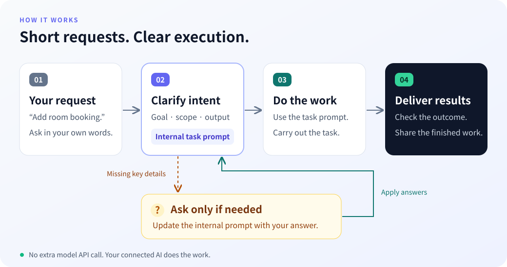
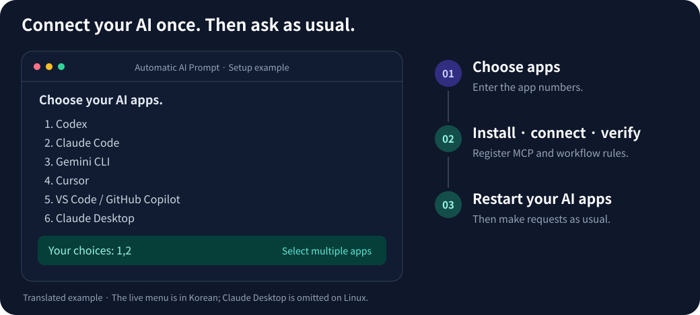

# Automatic AI Prompt

[한국어](README.md) · **English**

**Keep your request short. Let your AI clarify it and do the work.**

Connect it to the AI you already use through MCP. Your AI identifies the goal and constraints, creates an **internal task prompt**, and follows it to complete the task. It asks questions only when essential information is missing.

[How it works](#how-it-works) · [Examples](#examples) · [Installation](#installation) · [Commands](#commands) · [Advanced guide](docs/advanced.en.md)

## How it works



1. **Ask in your own words.** Briefly describe what you want done.
2. **Your AI clarifies the intent.** It uses context already available in the conversation to define the goal, constraints, deliverable, and success criteria in an internal prompt.
3. **It asks only when needed.** If a missing detail would materially change the result, it asks and incorporates your answer into that prompt.
4. **It completes the task and shows the result.** You do not need to approve an intermediate prompt or say “execute” again.

**The connected AI performs this workflow itself.** The server makes no additional model API calls.

## Examples

These examples illustrate how a request turns into completed work. The internal instructions are summarized for explanation; during normal use, you receive the task result rather than the intermediate prompt.

### 1. Add meeting-room booking to an existing project

**Request**

> Add meeting-room booking for our team to the current project. Just make sure reservations do not overlap.

**Essential clarification**

The AI first examines the project's UI, authentication, and data storage. It does not ask you to repeat information available in the code. It checks only the business rules that affect the implementation.

> Can any signed-in team member make a booking? Should overlapping times be blocked only for the same room?

**Your answer**

> Yes. Only block overlaps for the same room. People should only be able to cancel their own bookings.

**Internal task instructions**

- Implement booking creation, viewing, and cancellation using the existing stack, authentication, and storage conventions.
- Reject overlapping bookings for the same room on the server as well as in the UI. Allow simultaneous bookings for different rooms.
- Restrict cancellation to the person who made the booking, with server-side authorization checks.
- Verify overlapping times, concurrent booking requests, and cancellation permissions.

**What you receive**

The AI modifies the code, runs the checks available in the environment, and reports the changes and verification results. You do not need to copy a prompt into another chat or request execution separately. Any checks it could not run are identified explicitly.

### 2. Decide what to improve from customer feedback

**Request**

> Look through the attached customer feedback and help us decide what to fix next. Our goal is to reduce churn, and we have two developers for two weeks. Make it something we can use to make a decision in our meeting.

**Internal task instructions**

- Group feedback by problem and link each problem to the supporting source material.
- Recommend priorities based on reducing churn. Do not invent impact figures or development estimates and present them as facts.
- Suggest a scope that accounts for two developers and two weeks, and label effort estimates as estimates.
- Prepare recommended tasks, selection reasons, items to defer, and open questions so the team can compare options and decide.

**What you receive**

The AI analyzes the attachments and produces evidence-linked priorities and a proposed scope. Since the goal and resource constraints are already provided, it does not ask for them again. It marks anything the available material cannot establish.

If you want the prompt itself, explicitly ask for **“a prompt only.”**

## Installation

### 1. Check the prerequisites

You need **Node.js 22 LTS (22.13 or later), or Node.js 24 or later**, **npm**, **Git**, and the AI app you want to connect. The repository is public, so no GitHub login or token is required.

For Cursor or VS Code, open your terminal **in the project folder where you want to use it**.

### 2. Run the setup command

Open **Install / update** in [Commands](#commands), copy the command, and run it. If PowerShell blocks `npx`, use **Windows install / update** instead.

### 3. Choose your AI apps



Enter your choices to **install the server → verify MCP connectivity → register MCP and workflow instructions in the selected apps**.

- One app: `1`
- Multiple apps: `1,2`
- All apps shown in the menu: `all`

Codex, Claude Code, and Gemini CLI use user-wide settings. Cursor and VS Code use the current project. Claude Desktop is supported on Windows and macOS and uses the workflow instructions provided by the MCP server.

The current setup menu and help text are in Korean. App names, client IDs, and numeric selection work as illustrated. On Linux, Claude Desktop is omitted from the menu. The task output follows the language of your request by default.

### 4. Restart your AI apps

**Fully quit and reopen** each selected app. Then make requests as usual. You do not need to run setup every time.

If an app asks you to trust the server or approve MCP tool use, handle that request in the app.

## Commands

Click a title to expand its command.

<details>
<summary>Install / update</summary>

```bash
npx -y git+https://github.com/dalgonamoo1/automatic-ai-prompt.git setup
```

</details>

<details>
<summary>Windows install / update</summary>

```powershell
npx.cmd -y git+https://github.com/dalgonamoo1/automatic-ai-prompt.git setup
```

</details>

<details>
<summary>Connect Codex and Claude Code</summary>

```bash
npx -y git+https://github.com/dalgonamoo1/automatic-ai-prompt.git setup --client codex --client claude_code
```

</details>

<details>
<summary>Preview changes</summary>

```bash
npx -y git+https://github.com/dalgonamoo1/automatic-ai-prompt.git setup --client codex --dry-run
```

</details>

<details>
<summary>Help</summary>

```bash
npx -y git+https://github.com/dalgonamoo1/automatic-ai-prompt.git setup --help
```

</details>

## Good to know

- **Existing settings are preserved:** Other MCP entries stay intact. Changed files are backed up as `.bak-*`. Reinstalling updates the managed instructions without duplicating them.
- **No extra API key:** The server makes no additional model calls. Your AI app's subscription and usage charges still apply.
- **Behavior varies by app:** Automatic tool use and result quality depend on the connected AI and how its app handles MCP instructions.
- **Web apps:** Apps such as ChatGPT web that require a server URL need a separate HTTPS deployment. See [Remote connections](docs/advanced.en.md#connect-apps-that-require-a-server-url).

Configuration paths, manual setup, deployment, and development commands are in the [Advanced guide](docs/advanced.en.md).

MIT License · [License](LICENSE)
