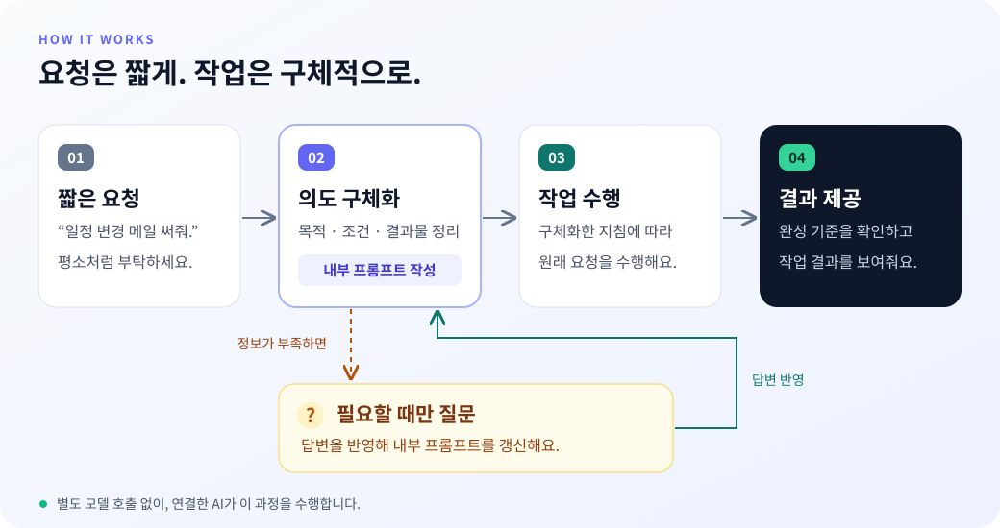
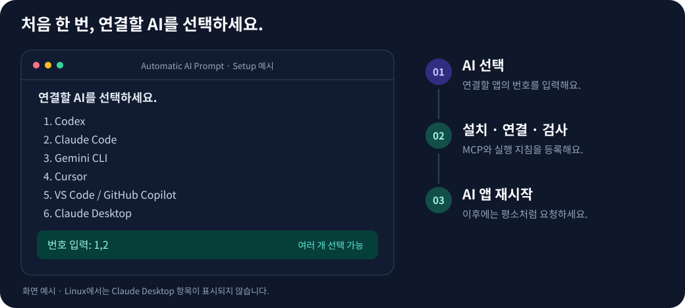

# Automatic AI Prompt

**한국어** · [English](README.en.md)

**요청은 짧게. AI는 의도를 구체화하고, 작업까지.**

이미 쓰는 AI에 MCP로 연결하면, AI가 요청의 목적과 조건을 정리하고 **내부 실행 프롬프트**를 만든 뒤 그 지침대로 작업합니다. 꼭 필요한 정보가 빠졌을 때만 질문합니다.

[작동 방식](#어떻게-작동하나요) · [사용 예시](#사용-예시) · [ChatGPT 연결](#chatgpt에서-사용하기) · [설치하기](#설치하기) · [명령어](#명령어) · [상세 설정](docs/advanced.md)

## 어떻게 작동하나요?



1. **평소처럼 부탁합니다.** 원하는 일을 짧게 적습니다.
2. **AI가 실행 프롬프트를 작성하고 기록합니다.** 목적·확인된 조건·결과물·완성 기준을 담은 실제 문안을 만들고 도구에 전달합니다. 문안이 없거나 비어 있으면 호출을 거절합니다.
3. **필요한 경우에만 질문합니다.** 초안과 핵심 질문을 먼저 기록합니다. 답변을 받으면 반영한 프롬프트를 새 개정으로 기록한 뒤 작업을 이어갑니다.
4. **작업을 수행하고 결과를 보여줍니다.** 중간 프롬프트를 승인하거나 다시 “실행해”라고 말할 필요가 없습니다.

이 과정은 **연결한 AI가 직접 수행**합니다. 별도 모델 API를 추가로 호출하지 않습니다.

### 도구 이름을 매번 말해야 하나요?

아니요. 기본 설치는 **일을 맡기면 먼저 `refine_prompt`를 사용하도록** 실행 지침도 추가합니다. "메일 써줘", "이 자료 요약해줘", "공부 계획 짜줘", "이 문장 고쳐줘"처럼 평소대로 요청하세요. 이미 구체적인 요청과 작은 수정도 대상이고, "이 자료 분석해 줄 수 있어?"처럼 질문 형태의 작업 요청도 포함합니다. 단순 지식 질문·인사·잡담은 제외합니다.

새 작업의 실행 프롬프트를 먼저 기록하고, 확인 질문에 답하면 갱신한 문안도 작업 전에 다시 기록합니다. MCP 목록에는 프로젝트 이름 대신 **`intent-bridge`**, 도구에는 **`refine_prompt`**가 표시됩니다.

자동 사용은 **현재 채팅에 도구가 제공되고 AI가 실행 지침을 적용할 때** 가능합니다. MCP 서버가 모든 메시지를 가로채거나 호출을 강제하는 구조는 아닙니다. 목록에 있어도 현재 채팅에서 도구가 제공되지 않을 수 있으며, `doctor`의 성공은 AI의 자동 호출까지 검증하지 않습니다. 수동 연결이거나 자동 호출이 안 된다면 [자동 적용 지침](examples/standing-instructions.ko.md)을 앱의 사용자 지침·프로젝트 규칙에 한 번 추가하고 새 채팅에서 확인하세요. `--no-instructions`로 설치하면 로컬 실행 지침 파일은 추가하지 않습니다.

### 실제 사용한 프롬프트도 확인할 수 있나요?

"처음 사용한 프롬프트 보여줘" 또는 "질문에 답한 뒤 사용한 프롬프트 보여줘"라고 요청하면, AI가 해당 도구 반환 기록의 **원문과 개정 번호**를 보여주도록 안내합니다. 그때 새로 만든 문안을 과거 원문이라고 제시하지 않습니다.

원문은 **MCP 호출·반환 기록**에 남으며 이 서버가 대화를 영구 저장하지는 않습니다. 기록이 현재 대화에서 사라졌다면 조회할 수 없다고 알려야 합니다. 입력 문안의 존재와 형식은 검증하지만, AI가 그 의미를 올바르게 작성하고 실제로 따랐는지까지 서버가 보증하지는 못합니다.

**0.5 버전부터 실행 프롬프트가 필수 입력입니다.** 로컬 설치는 업데이트 후 앱을 재시작하고, ChatGPT 플러그인은 서버 재배포 후 새 채팅에서 사용하세요. 사용자가 직접 프롬프트를 써서 입력할 필요는 없습니다.

## 사용 예시

아래는 요청이 실제 작업으로 이어지는 흐름을 보여주는 예시입니다. 내부 지침은 설명을 위해 요약한 것이며, 평소 사용에서는 중간 프롬프트 대신 작업 결과를 받습니다.

### 1. 기존 프로젝트에 회의실 예약 기능 추가

**요청**

> 지금 프로젝트에 우리 팀이 쓸 회의실 예약 기능 붙여줘. 시간이 겹치지만 않게 해줘.

**필요한 확인**

AI는 먼저 프로젝트의 화면·로그인·데이터 저장 구조를 살펴봅니다. 기존 코드에서 확인할 수 있는 정보는 다시 묻지 않고, 구현을 바꾸는 업무 규칙만 확인합니다.

> 예약은 로그인한 팀원 누구나 할 수 있나요? 시간 중복은 같은 회의실 기준으로 막으면 되나요?

**답변**

> 응. 같은 회의실만 중복을 막아줘. 예약 취소는 본인 것만 가능하게 해줘.

**내부에서 구체화하는 지침**

- 기존 기술 스택과 로그인·데이터 저장 방식을 활용해 예약 생성·조회·취소를 구현한다.
- 같은 회의실의 예약 시간이 겹치면 서버에서도 거절한다. 다른 회의실의 동시간 예약은 허용한다.
- 취소 권한은 예약자에게만 부여하고, 화면뿐 아니라 서버에서도 확인한다.
- 시간 중복, 동시에 들어온 예약 요청, 취소 권한을 검증한다.

**받게 되는 결과**

AI는 위 지침에 따라 코드를 수정하고, 가능한 실행·테스트로 동작을 확인한 뒤 변경 내용과 확인 결과를 알려줍니다. 프롬프트를 복사해 다시 전달하거나 별도로 실행을 요청할 필요가 없습니다. 실행 환경 때문에 확인하지 못한 부분은 구분해 설명합니다.

### 2. 고객 피드백으로 다음 개선 작업 결정

**요청**

> 첨부한 고객 피드백 보고 다음에 뭘 고치면 좋을지 정리해줘. 이번 목표는 이탈 줄이기고, 개발자 2명이 2주 동안 할 수 있는 정도면 돼. 회의에서 바로 결정할 수 있게 해줘.

**내부에서 구체화하는 지침**

- 피드백을 문제별로 묶고, 각 문제의 근거가 되는 원문을 연결한다.
- 이탈 감소라는 목표에 맞춰 우선순위를 제안한다. 자료에 없는 효과 수치나 개발 공수를 사실처럼 만들지 않는다.
- 개발자 2명·2주라는 조건을 고려해 작업 범위를 제안하고, 예상 공수는 추정으로 표시한다.
- 회의에서 비교·결정할 수 있도록 추천 과제, 선정 이유, 이번에 미룰 항목, 추가 확인 사항을 정리한다.

**받게 되는 결과**

AI는 첨부 자료를 분석해 근거가 연결된 개선 우선순위와 작업 범위 제안을 작성합니다. 목표와 자원 조건이 이미 주어졌으므로 같은 내용을 다시 질문하지 않습니다. 자료만으로 판단할 수 없는 부분은 별도로 표시합니다.

프롬프트 자체가 필요할 때만 **“프롬프트만 만들어줘”**라고 요청하세요.

## ChatGPT에서 사용하기

ChatGPT 일반 채팅에서는 **원격 MCP 플러그인**으로 연결합니다. 이 저장소에 ChatGPT용 서버도 포함되어 있으며, Codex 로컬 설치와 별도로 연결합니다. 추가 모델 API 키나 npm 공개는 필요하지 않습니다.

1. ChatGPT용 서버를 한 번 배포합니다. [배포 안내](docs/advanced.md#chatgpt용-worker-배포)를 참고하세요. Sites로 배포하면 해당 계정용 플러그인이 생성됩니다.
2. ChatGPT의 **Plugins → Personal → Created by you**에서 생성된 **Automatic AI Prompt**를 찾아 **Install / Connect**를 완료합니다. 다른 계정이 배포한 연결은 공유받은 플러그인에서 설치합니다.
3. 새 채팅에서 플러그인을 선택하고 "일주일 영어 공부 계획 짜줘"처럼 평소대로 요청합니다. 도구 이름을 매번 적을 필요는 없습니다.
4. 도구 실행 기록에서 **`refine_prompt`** 호출을 확인합니다. 플러그인이 목록에 있거나 답변이 나온 것만으로 호출 성공을 판단하지 마세요.

플러그인이 설치된 채팅에서 자동 사용하도록 안내하지만, ChatGPT가 도구를 선택하는 동작까지 서버가 강제하지는 못합니다. 메뉴와 이용 가능 여부는 앱 버전·계정·관리자 설정에 따라 달라질 수 있습니다. 비공개 배포는 해당 계정용이며 GitHub 저장소 공개가 플러그인 공유로 이어지지는 않습니다.

소스를 보관하거나 다른 AI로 다시 만들려면 [플러그인 재생성 안내](docs/rebuild-plugin.md)를 사용하세요. 개인·Pro 계정의 Sites 플러그인은 현재 다른 사용자에게 링크로 직접 공유할 수 없으며, Business·Enterprise 워크스페이스 공유는 플러그인과 Site 권한이 필요합니다.

## 설치하기

아래 명령은 Codex·Claude Code 등 로컬 AI 앱용입니다. ChatGPT 일반 채팅은 위의 플러그인 연결을 사용하세요. 같은 로컬 환경을 쓰는 ChatGPT 데스크톱 작업 모드의 MCP 설정 공유와 일반 채팅용 원격 연결은 구분됩니다.

### 1. 준비하기

**Node.js 22 LTS(22.13 이상) 또는 24 이상**, **npm**, **Git**, 연결할 AI 앱이 필요합니다. 저장소가 공개되어 있어 GitHub 로그인이나 토큰은 필요하지 않습니다.

Cursor나 VS Code에 연결하려면 **사용할 프로젝트 폴더에서** 터미널을 열어 주세요.

### 2. 설치 명령 실행하기

[명령어](#명령어)에서 **설치**를 펼쳐 복사한 뒤 실행하세요.

### 3. 연결할 AI 선택하기



번호를 입력하면 **서버 설치 → MCP 연결 검사 → 선택한 앱에 MCP·실행 지침 등록**까지 진행합니다.

- 하나만 선택: `1`
- 여러 개 선택: `1,2`
- 화면에 나온 앱 전체: `all`

Codex·Claude Code·Gemini CLI는 사용자 전체에, Cursor·VS Code는 현재 프로젝트에 설정합니다. Claude Desktop은 Windows와 macOS에서 지원하며, MCP 서버가 제공하는 실행 지침을 사용합니다.

### 4. AI 앱 재시작하기

선택한 앱을 **완전히 종료한 뒤 다시 열면** 됩니다. 이후에는 평소처럼 요청하세요. 매번 설치 명령을 실행할 필요가 없습니다.

앱에서 MCP 사용 승인이나 서버 신뢰를 요청하면 해당 앱에서 허용해 주세요.

## 명령어

제목을 누르면 명령어가 펼쳐집니다. **설치**는 연결할 AI를 선택하고, **업데이트**는 기존 연결을 유지해 최신 버전으로 갱신합니다. 등록된 대상은 **연결 목록**, 서버 응답은 **연결 진단**으로 확인할 수 있습니다.

**제거**는 이 도구의 MCP 연결과 관리 지침을 해제합니다. 다른 설정과 사용자 지침은 보존하고, 서버 파일과 백업도 남깁니다.

**도움말**은 사용법과 옵션을 보여줍니다. **미리보기**는 변경할 대상만 확인하고 AI 설정을 바꾸거나 연결을 제거하지 않습니다.

Windows PowerShell에서 `npx` 실행이 차단되면, 아래 명령의 **`npx`만 `npx.cmd`로 바꿔서** 실행하세요.

<details>
<summary>설치</summary>

```bash
npx -y git+https://github.com/dalgonamoo1/automatic-ai-prompt.git setup
```

</details>

<details>
<summary>업데이트</summary>

```bash
npx -y --prefer-online git+https://github.com/dalgonamoo1/automatic-ai-prompt.git update
```

</details>

<details>
<summary>연결 진단</summary>

```bash
npx -y --prefer-online git+https://github.com/dalgonamoo1/automatic-ai-prompt.git doctor
```

</details>

<details>
<summary>연결 목록</summary>

```bash
npx -y --prefer-online git+https://github.com/dalgonamoo1/automatic-ai-prompt.git list
```

</details>

<details>
<summary>제거</summary>

```bash
npx -y --prefer-online git+https://github.com/dalgonamoo1/automatic-ai-prompt.git uninstall
```

</details>

<details>
<summary>도움말</summary>

```bash
npx -y --prefer-online git+https://github.com/dalgonamoo1/automatic-ai-prompt.git --help
```

</details>

<details>
<summary>설치 미리보기</summary>

```bash
npx -y --prefer-online git+https://github.com/dalgonamoo1/automatic-ai-prompt.git setup --dry-run
```

</details>

<details>
<summary>업데이트 미리보기</summary>

```bash
npx -y --prefer-online git+https://github.com/dalgonamoo1/automatic-ai-prompt.git update --dry-run
```

</details>

<details>
<summary>제거 미리보기</summary>

```bash
npx -y --prefer-online git+https://github.com/dalgonamoo1/automatic-ai-prompt.git uninstall --dry-run
```

</details>

AI별 선택, JSON 출력, 세부 옵션은 [상세 설정](docs/advanced.md)에서 확인하세요.

## 알아두기

- **기존 설정 보존:** 다른 MCP 항목은 유지하고, 수정 전 원본은 `.bak-*` 파일로 백업합니다. 다시 설치해도 실행 지침을 중복 추가하지 않습니다.
- **별도 API 키 불필요:** 추가 모델 호출은 없습니다. 사용하는 AI 앱의 구독·사용량 요금은 별도입니다.
- **앱별 동작 차이:** 도구의 자동 호출과 결과 품질은 연결한 AI 및 앱의 MCP 지원 방식에 따라 달라질 수 있습니다.
- **웹 앱 연결:** ChatGPT 웹처럼 서버 URL을 요구하는 앱은 별도 HTTPS 배포가 필요합니다. [원격 연결 방법](docs/advanced.md#url을-요구하는-앱에-연결)을 확인하세요.

설정 파일 위치, 수동 설치, 배포, 개발용 명령은 [상세 안내](docs/advanced.md)에 정리했습니다.

MIT License · [라이선스](LICENSE)
